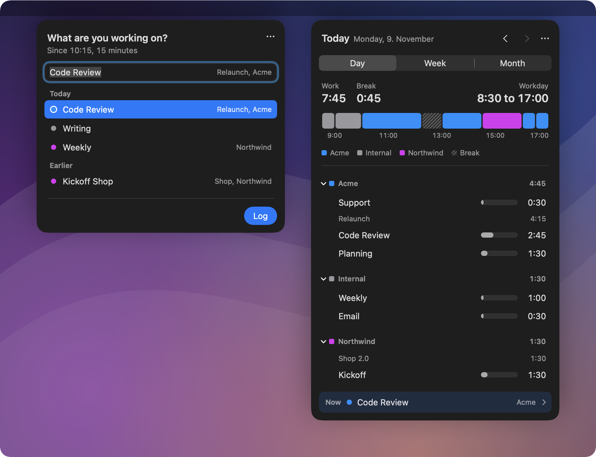

  

<h1 align="center">maloche</h1>

A calm menu bar time tracker for macOS. Every now and then it asks what you are working on, and your day fills itself.

  <a href="https://github.com/antonztsv/maloche/releases/latest"><strong>Download the latest release</strong></a> 
  macOS 26 or later, free and open source

  

## How it works

- At an interval you choose, maloche asks "What are you working on?" in a small panel below its menu bar icon.
- One answer books the time since the last one: type a few letters, press Return.
- The dashboard shows your day, week and month by customer, project and activity.

## Private by design

Everything stays on your Mac: no server, no account, no telemetry, and the update check only runs once you turn it on.

## Install

1. Download `maloche-<version>.dmg` from the [latest release](https://github.com/antonztsv/maloche/releases/latest) and open it.
2. Drag maloche onto the Applications folder.
3. Open maloche from Applications. macOS blocks this first launch because the app is not notarized.
4. Open System Settings > Privacy & Security, click "Open Anyway" next to the message about maloche and confirm.

Why it is not notarized

Notarization needs an Apple Developer ID, and maloche is signed with a self-signed certificate instead. That is why macOS asks you to confirm the first launch. On macOS 15 and later the "Open Anyway" button only appears after you have tried to open the app once.

Without a Developer ID there is no Team ID. With the hardened runtime on, macOS would then refuse to load the bundled Sparkle framework (used for the update check), because library validation requires the app and its libraries to share a Team ID. So the app has the `com.apple.security.cs.disable-library-validation` entitlement. Only library validation is turned off, the other hardened runtime protections stay on.

## Development

Building from source, releases and where maloche keeps its data: [docs/development.md](docs/development.md).

## License

MIT, see [LICENSE](LICENSE). The bundled GRDB.swift and Sparkle are MIT licensed as well (Sparkle also contains code under BSD, MIT and zlib style licenses), see [THIRD_PARTY_LICENSES.md](THIRD_PARTY_LICENSES.md).
