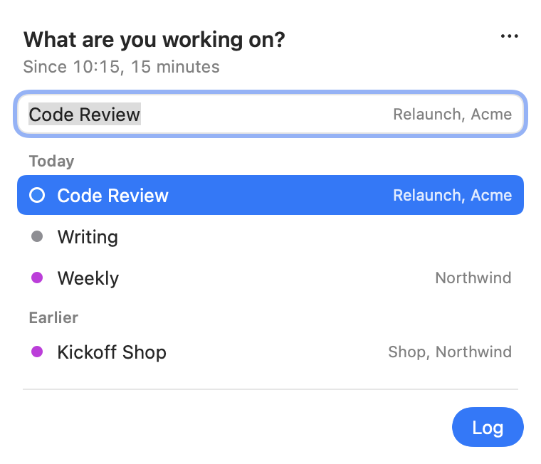
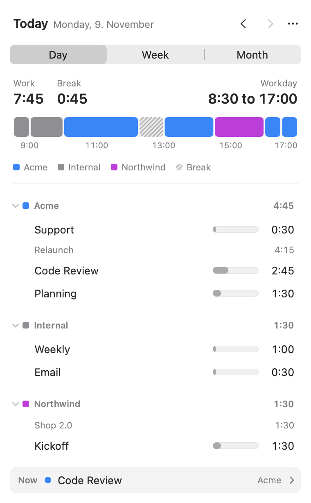
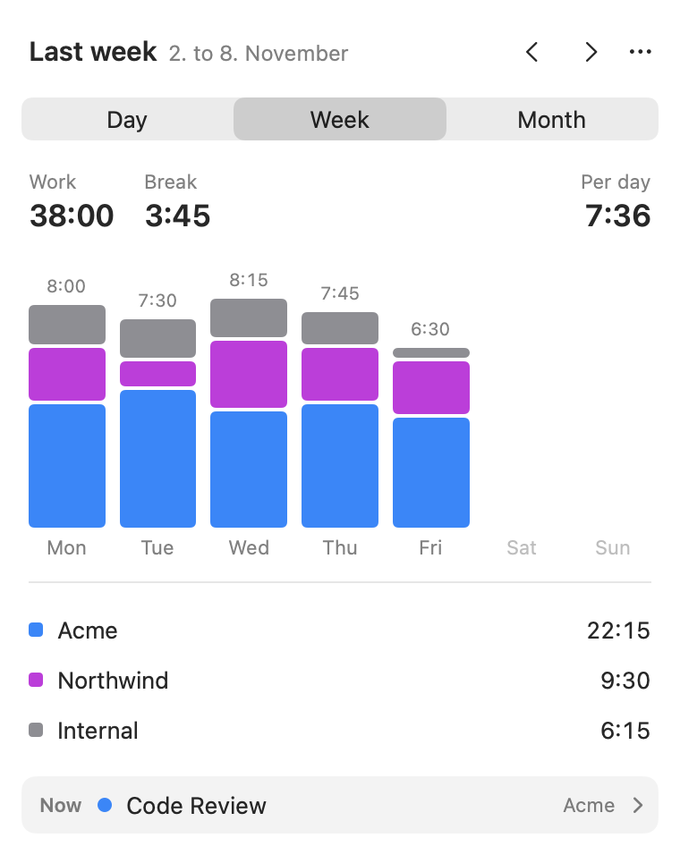

# maloche

A native macOS menu bar time tracker. At an interval it asks "What are you working on?" and books the time since the last answer to what you type. Everything stays on your Mac: no server, no account, no telemetry. The only network access is the update check, and it is off until you turn it on. MIT licensed.

<p>
  
  
  
</p>

## Install

1. Download the zip from the Releases page and unzip it.
2. Move `maloche.app` to your Applications folder.
3. Open it. macOS blocks the first launch because the app is signed with a self-signed certificate (see below).
4. Open System Settings > Privacy & Security, scroll to the Security section, click "Open Anyway" next to the message about maloche and confirm. On macOS 15 and later this button only appears after you have tried to open the app once.
5. Open maloche again.

Requires macOS 26 or later.

## Why it is not notarized

Notarization needs an Apple Developer ID, and maloche is signed with a self-signed certificate instead. That is why macOS asks you to confirm the first launch.

Without a Developer ID there is no Team ID. With the hardened runtime on, macOS would then refuse to load the bundled Sparkle framework (used for the update check), because library validation requires the app and its libraries to share a Team ID. So the app has the `com.apple.security.cs.disable-library-validation` entitlement. Only library validation is turned off, the other hardened runtime protections stay on. With a Developer ID this entitlement would not be needed.

## Build from source

You need macOS 26 or later and Xcode with the Swift 6 toolchain.

```bash
swift build
swift test
scripts/build-app.sh
```

`scripts/build-app.sh` signs the app, so it needs a local signing identity. `scripts/make-signing-cert.sh` creates a self-signed one in your login keychain (read the script first). The dev build lands in `build/maloche Dev.app` and uses its own bundle ID with a `.dev` suffix, so it never touches your real data.

For a release build run `scripts/build-app.sh --release`. `scripts/release.sh` builds from a clean commit, signs, verifies and zips the app into `build/release/`.

## Data

maloche keeps one SQLite database in the Application Support folder under its bundle ID: `~/Library/Application Support/io.github.antonztsv.maloche/`. Nothing leaves your Mac.

maloche backs up the database once a day (the last 30 are kept), by default into a `Backups` folder next to it; Settings > Backup lets you pick another folder, back up now or restore a backup. If you used Daily before, the same pane has "Import from Daily", which reads its JSON export of activities and timesheet.

## License

MIT.
